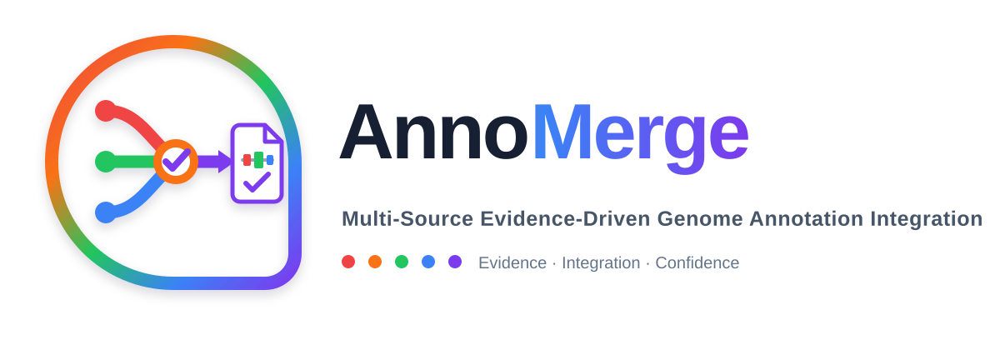
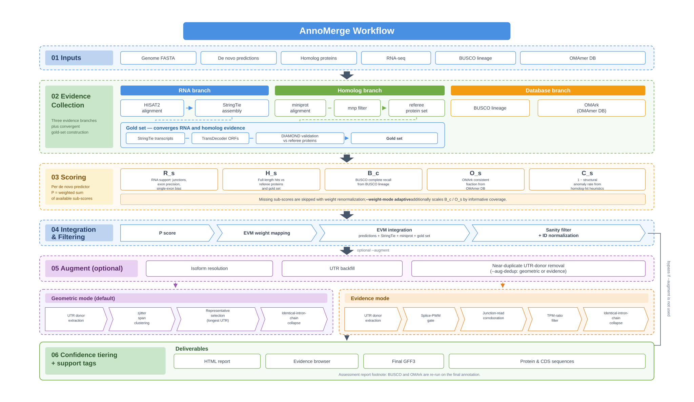

<p align="center">
  
</p>

# Workflow

<p align="center">
  
</p>

# Installation

```bash
# step1 create environment
conda create -n annomerge -c conda-forge -c bioconda pysam typer jinja2 pyyaml miniprot hisat2 samtools mosdepth stringtie diamond transdecoder evidencemodeler gffread gffcompare busco omark -y
# step2 clone this repository 
git clone https://github.com/Steven-Stimson/annomerge.git
```
